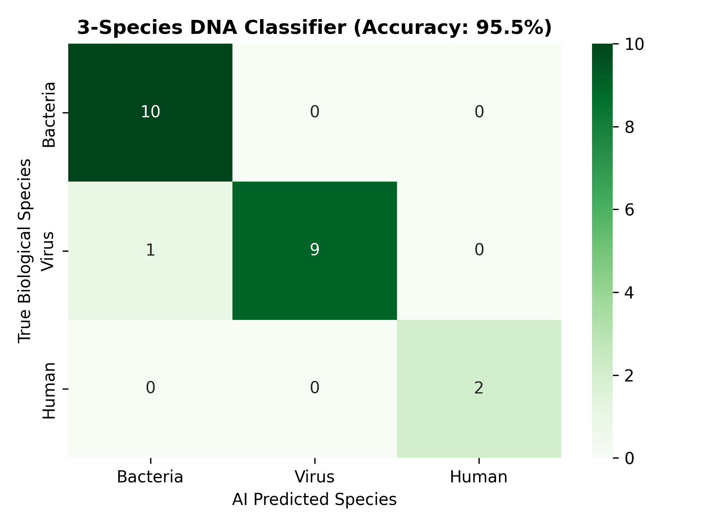

# DNA Sequence Classification Using k-mers & Machine Learning

A supervised machine learning pipeline built in Python (`Biopython`, `scikit-learn`, `Pandas`, `Seaborn`) that predicts the biological origin of unknown DNA sequences (**Bacteria**, **Virus**, or **Human**) using k-mer sequence representation.

## Project Overview & Workflow
1. **Automated NCBI Sequence Retrieval (`Bio.Entrez`):** Fetched real nucleotide FASTA records from NCBI GenBank across three distinct biological classes: *Escherichia coli* (16S rRNA), SARS-CoV-2 (Spike gene), and *Homo sapiens* (*HBB* beta-globin mRNA)[cite: 10, 13].
2. **k-mer Feature Engineering (`CountVectorizer`):** Converted raw `A/T/G/C` DNA strings into overlapping 4-letter DNA words (`k = 4`) and vectorized them into a numerical frequency matrix[cite: 11].
3. **Model Training & Evaluation (`MultinomialNB`):** Trained a Multinomial Naive Bayes classifier on an 80/20 stratified train-test split, achieving **95.5% overall classification accuracy** on unseen test sequences and 100% confidence on live sequence inference[cite: 13].

